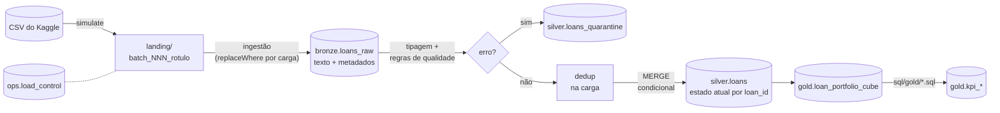
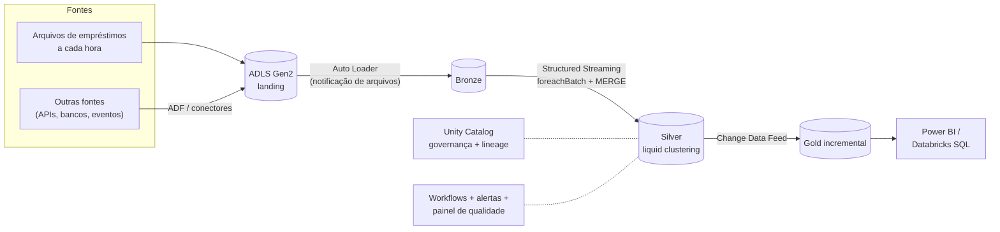

# Pipeline da carteira de empréstimos (Lending Club)

Solução de dados para ingerir, tratar, validar e disponibilizar a carteira de empréstimos do dataset
[All Lending Club Loan Data](https://www.kaggle.com/datasets/wordsforthewise/lending-club) (empréstimos
aceitos, 2007–2018), com cargas incrementais e reprocessamento seguro.

## Resumo

- **Stack:** PySpark 4.0 + Delta Lake 4.0, arquitetura medallion (bronze → silver → gold), executado em
  Docker. O mesmo código roda no Databricks (Runtime 17+), que reaproveita a sessão Spark já existente.
- **Cargas incrementais:** o snapshot do Kaggle é fatiado em cargas por safra, e parte dos empréstimos
  chega primeiro numa versão inicial e depois como atualização. Ao final, a silver reproduz exatamente o
  snapshot original (verificado em teste).
- **Idempotência:** reprocessar a mesma carga não duplica nem altera nada; reprocessar uma carga antiga
  não sobrescreve dados mais novos; um arquivo reentregue com correção é detectado pelo checksum e aplicado.
- **Qualidade:** contrato de colunas por carga, 9 regras que mandam a linha para a quarentena e 10 que só
  sinalizam, portão de taxa de quarentena e validação da chave após o MERGE, com rollback automático
  (time travel do Delta).
- **Camada analítica:** cubo com medidas aditivas + consultas SQL versionadas para os indicadores pedidos
  (por safra, trimestre, UF, grade e finalidade).
- **Evidências:** [profiling do dado real](docs/profiling_report.md), [cargas simuladas](docs/simulation_summary.md),
  [indicadores](docs/kpi_report.md) e [demonstração de reprocessamento](docs/evidence_reprocessamento.md),
  todos gerados pelo próprio pipeline. 62 testes automatizados rodam no CI (GitHub Actions).
- **Uso de IA:** documentado em [AI_USAGE.md](AI_USAGE.md).

**Resultado no dataset completo:** 2.260.701 linhas lidas, 2.260.668 empréstimos na silver (todos os ids
válidos) e 33 linhas de rodapé em quarentena, em 13 cargas processadas em ~13 minutos numa máquina local.
Carteira de US$ 34,0 bi financiados, US$ 9,5 bi de saldo de principal em aberto, taxa média ponderada de
13,38% a.a. e taxa de default de 11,92% sobre o total (19,98% sobre os empréstimos já encerrados).

## Arquitetura



| Camada | Tabela | Conteúdo |
|---|---|---|
| Landing | `data/landing/batch_NNN_<rótulo>/` | Um diretório CSV por carga. A sequência `NNN` define a ordem. |
| Bronze | `bronze/loans_raw` | O dado como chegou (todas as colunas como texto) + `_batch_id`, `_batch_seq`, `_source_file`, `_ingested_at`, `_run_id`. Particionada por carga. |
| Silver | `silver/loans` | Uma linha por empréstimo, tipada e validada, no estado mais recente. Change Data Feed habilitado. |
| Silver | `silver/loans_quarantine` | Linhas rejeitadas, com as regras violadas e os valores originais (`_raw`). |
| Gold | `gold/loan_portfolio_cube` e `gold/kpi_*` | Cubo de medidas aditivas e tabelas de indicadores. |
| Ops | `ops/load_control` | Log de cada tentativa de carga: status, checksum, contagens, versão da silver, erro. |

## Como executar

Pré-requisitos: Docker Desktop (Windows/macOS) ou Docker Engine (Linux) com pelo menos 8 GB de memória, e o
arquivo `accepted_2007_to_2018Q4.csv.gz` do Kaggle em `data/raw/`.

```bash
docker compose build                                  # Java 17 + PySpark 4.0 + Delta 4.0 (jars baixados no build)
docker compose run --rm tests                         # testes automatizados

docker compose run --rm pipeline profile              # 1. profiling do arquivo bruto  -> docs/profiling_report.md
docker compose run --rm pipeline simulate             # 2. gera as cargas em landing   -> docs/simulation_summary.md
docker compose run --rm pipeline run                  # 3. processa todas as cargas e reconstrói a gold
docker compose run --rm pipeline report               # 4. indicadores e qualidade     -> docs/kpi_report.md
docker compose run --rm pipeline status               # situação de cada carga

# Reprocessar uma carga específica (sem reconstruir o histórico)
docker compose run --rm pipeline run --batch batch_005_2011 --force
# Demonstração de reexecução de carga já processada  -> docs/evidence_reprocessamento.md
docker compose run --rm pipeline demo-reprocess --batch batch_005_2011

# Recomeçar do zero (apaga cargas simuladas e lakehouse; o dataset em data/raw fica)
docker compose down -v
```

Sem Docker: Python 3.11 + Java 17, `pip install -r requirements.txt -r requirements-dev.txt` e os mesmos
comandos com `PYTHONPATH=src python -m lending_pipeline <comando>`. Configuração em
[`config/pipeline.toml`](config/pipeline.toml), com qualquer chave sobrescrevível por variável de ambiente
(`LENDING_<SEÇÃO>_<CHAVE>`).

Tempos medidos no dataset completo (PC local, Docker Desktop, 8 GB para o Spark):

| Etapa | Tempo |
|---|---:|
| `docker compose build` (primeira vez) | ~4 min |
| `profile` | ~1,5 min |
| `simulate` | ~5,5 min |
| `run` (13 cargas + gold) | ~13 min |
| `report` | < 1 min |
| `demo-reprocess` | ~1,5 min |

## Decisões técnicas

### Chave do empréstimo: `id`

`id` é o identificador único da listagem atribuído pelo Lending Club. `member_id` não serve: vem vazio no
dataset público. O [profiling](docs/profiling_report.md) confirma unicidade e mostra que os únicos `id` não
numéricos são linhas de rodapé do arquivo ("Total amount funded in policy code..."), que vão para a
quarentena. Na silver, `id` vira `loan_id` (`bigint`).

Números do profiling: 2.260.701 linhas no arquivo, das quais 2.260.668 têm `id` numérico, todos distintos (nenhum `id` repetido e nenhuma linha duplicada). As 33 restantes são rodapés, com todas as demais colunas vazias. `member_id` está vazio em 100% das linhas.

### Tipos

A bronze guarda tudo como texto, para nunca perder dado na entrada. A tipagem acontece na silver:

| Coluna(s) | Tipo | Tratamento |
|---|---|---|
| `loan_id` | `bigint` | Só aceita `id` puramente numérico |
| Valores monetários (`loan_amnt`, `funded_amnt`, `out_prncp`, pagamentos...) | `decimal(18,2)` | Decimal, e não double, para somas financeiras exatas |
| `int_rate` | `decimal(9,4)` | Aceita `13.56` e `13.56%` |
| `term_months` | `int` | `" 36 months"` → 36 |
| `emp_length_years` | `int` | `"< 1 year"` → 0, `"10+ years"` → 10, `"n/a"` → nulo |
| `issue_date`, `last_pymnt_date`, ... | `date` | Formato de origem `MMM-yyyy` (ex.: `Dec-2015` → 2015-12-01) |
| `grade`, `addr_state`, `purpose`... | `string` | `trim`, vazio vira nulo, caixa padronizada |
| `is_default`, `is_resolved`, `meets_credit_policy` | `boolean` | Derivados do `loan_status` (ver abaixo) |

O Spark 4 roda com ANSI ligado: um `cast` de texto inválido derruba o job. Toda conversão usa `try_cast` /
`try_to_timestamp`; o valor inválido vira nulo e a regra de qualidade decide o destino da linha.

Colunas de texto livre (`desc`, `emp_title`, `title`) e de identificação indireta ficam só na bronze: a silver
publica apenas o necessário para a análise (minimização de dados).

### Duplicados, ausentes e inconsistentes

- **Duplicados na mesma carga** (linhas idênticas ou duas versões do mesmo empréstimo): fica uma versão por
  `loan_id`, a mais recente pelo último pagamento, depois pela última consulta de crédito, depois pelo total
  pago. Sem isso o MERGE do Delta aborta (duas linhas da origem para a mesma linha do destino).
- **Duplicados entre cargas:** resolvidos pelo MERGE (ver abaixo).
- **Ausentes e inconsistentes:** regras com dois níveis de severidade em [`quality.py`](src/lending_pipeline/quality.py).
  `error` manda para a quarentena (ex.: `loan_id` inválido, `term` fora de 36/60, `loan_status` desconhecido,
  valor ≤ 0). `warning` publica e marca em `_dq_warnings` (ex.: `funded_amnt_inv > funded_amnt`, `dti`
  fora de faixa, encerrado com saldo em aberto). O critério: só rejeita o que tornaria o indicador errado;
  o que é estranho mas plausível é sinalizado, não descartado.

**O que o profiling do dado real mudou** ([relatório](docs/profiling_report.md)):

- Confirmou que as únicas linhas inválidas do arquivo são os 33 rodapés: nenhuma regra de erro dispara em
  empréstimo real, então a quarentena não descarta dado legítimo.
- Revelou três situações não previstas, que viraram alertas (não erros, porque nenhuma invalida os
  indicadores): 4.537 empréstimos `Current` com saldo zero (provavelmente quitados perto da data do
  snapshot), 21 com principal recebido maior que o valor financiado e 1.667 com renda anual ≤ 0.
- Mostrou que `funded_amnt` é menor que `loan_amnt` em 2.065 empréstimos: valor originado e valor financiado
  diferem de fato, o que justifica reportar os dois. `dti` passa de 100 em 2.561 casos (alerta já previsto).

### Cargas incrementais simuladas

O dataset é um retrato único (estado de cada empréstimo no fim de 2018). Para exercitar novos registros e
atualizações ([`simulate.py`](src/lending_pipeline/simulate.py)):

1. cada safra (ano de `issue_d`) vira uma carga;
2. 30% dos empréstimos cujo status mudou desde a originação chegam primeiro como versão inicial (Current,
   saldo cheio, nada pago) e a versão real chega na carga seguinte; a última safra ganha uma carga só de
   atualizações;
3. algumas cargas trazem duas versões do mesmo empréstimo e linhas repetidas, e as linhas de rodapé são
   distribuídas entre as cargas.

A amostragem usa hash do `id` (não `rand()`), então a simulação é determinística. Resultado em
[docs/simulation_summary.md](docs/simulation_summary.md).

### Idempotência e reprocessamento

| Camada | Mecanismo |
|---|---|
| Bronze e quarentena | Cada carga substitui atomicamente a própria partição (`replaceWhere`). |
| Silver | `MERGE` por `loan_id`: insere novos; atualiza só se o conteúdo mudou (`_row_hash`) **e** a carga é igual ou mais nova que a da versão atual (`_batch_seq`). |
| Controle | Carga já processada com sucesso e mesmo checksum é ignorada (`SKIPPED`); checksum diferente = reentrega corrigida, reprocessada automaticamente; `--force` reprocessa sempre. |

Consequências: reexecutar não duplica; reprocessar uma carga antiga (ou fora de ordem) não sobrescreve dado
mais novo; uma carga corrigida atualiza só o que ainda "pertence" a ela. A gold é reconstruída a partir da
silver a cada execução, então fica sempre consistente.

### Quando os dados foram processados

Toda linha carrega `_batch_id`, `_batch_seq`, `_source_file` e `_run_id`. A silver tem ainda
`_first_loaded_at` (primeira carga do empréstimo) e `_last_updated_at` (última alteração). A
`ops.load_control` guarda início, fim, contagens e versão da silver de cada tentativa, e o histórico do
Delta permite consultar qualquer versão anterior (`VERSION AS OF`).

## Camada analítica

### Definições

| Indicador | Definição |
|---|---|
| Quantidade de empréstimos | Contagem de `loan_id` |
| Valor originado | Soma de `loan_amnt` (valor aprovado na listagem) |
| Valor financiado | Soma de `funded_amnt` (valor efetivamente comprometido) |
| Saldo de principal em aberto | Soma de `out_prncp` (zero para quitados e baixados) |
| Taxa média de juros | Média simples de `int_rate` |
| Taxa média ponderada | `Σ(int_rate × funded_amnt) / Σ funded_amnt` |
| Empréstimos e valor em default | Contagem e soma de `funded_amnt` dos empréstimos em default; também a perda de principal (`funded_amnt − total_rec_prncp`) |
| Taxa de default | Sobre o total **e** sobre os encerrados (Fully Paid, Charged Off, Default). Safras recentes ainda estão em aberto, então a taxa sobre o total subestima o risco delas. |

**Default = perda realizada:** `loan_status` normalizado igual a `Charged Off` ou `Default`, incluindo os
empréstimos de 2007–2010 fora da política de crédito (`Does not meet the credit policy. Status:Charged Off`).
`Default` (121+ dias de atraso) entra porque precede a baixa. Atrasos (`Late`, `In Grace Period`) não entram:
medem inadimplência, não perda, e o bucket `Late (31-120 days)` mistura faixas de risco muito diferentes. A
definição está centralizada em [`schema.py`](src/lending_pipeline/schema.py).

### Tabelas e consultas

`gold.loan_portfolio_cube` agrega no grão (safra, trimestre, UF, grade, finalidade) e guarda **só medidas
aditivas**: contagens, somas e os numeradores e denominadores das taxas. Taxa não se soma; média de médias
dá número errado. Cada consulta em [`sql/gold/`](sql/gold/) recalcula as taxas a partir das somas, no recorte
que precisa:

| Tabela | Recorte |
|---|---|
| `kpi_portfolio_summary` | Carteira inteira |
| `kpi_by_period` / `kpi_by_quarter` | Safra (ano) / trimestre de originação |
| `kpi_by_state` | UF |
| `kpi_by_grade` | Grade de risco |
| `kpi_by_purpose` | Finalidade |
| `kpi_by_period_grade` | Safra × grade (risco ao longo do tempo) |

Resultados completos: [docs/kpi_report.md](docs/kpi_report.md). Destaques:

- **O grade discrimina risco como esperado:** a taxa de default sobre encerrados vai de 6,0% no grade A a
  49,7% no G, e a taxa ponderada de 7,1% a 28,1%.
- **Por que reportar duas taxas de default:** na safra 2018, a taxa sobre o total é 1,8% e sobre os
  encerrados é 15,8%. A maior parte dos empréstimos de 2018 ainda estava em aberto no snapshot; olhar só
  a primeira taxa daria a falsa impressão de uma safra muito melhor que as anteriores.
- **Finalidade de maior risco:** `small_business`, com 29,9% de default sobre encerrados, contra 16,9% em
  `credit_card`.

## Qualidade e operação

**Validações automatizadas**, em três níveis:

1. **Contrato da carga:** colunas obrigatórias presentes; falha antes de qualquer escrita.
2. **Linha a linha:** regras `error` (quarentena) e `warning` (sinalização).
3. **Carga e tabela:** taxa de quarentena acima de 5% reprova a carga inteira; depois do MERGE, `loan_id`
   precisa ser único e não nulo, senão o MERGE é desfeito (`RESTORE` para a versão anterior).

**Reexecução de carga já processada:** é ignorada pelo checksum; com `--force`, passa pelo pipeline e não
altera nada. Evidência em [docs/evidence_reprocessamento.md](docs/evidence_reprocessamento.md), gerada por
`demo-reprocess`, e em teste automatizado.

**Identificação e tratamento de erros:**

- toda falha vira uma linha `FAILED` em `ops.load_control` com a mensagem de erro, e o processo sai com
  código 1 (o orquestrador detecta e alerta);
- a execução para na carga com falha; as linhas rejeitadas ficam na quarentena com o valor original e as
  regras violadas, para investigar;
- a silver nunca fica num estado intermediário: o MERGE é atômico, e a validação pós-carga desfaz o MERGE
  se a tabela final violar a chave;
- se o processo morrer no meio, não há registro de sucesso e a carga é reprocessada na próxima execução, o
  que é seguro porque todas as escritas são idempotentes.

**Reprocessar uma carga específica:** `run --batch <id> --force`. Só aquela partição da bronze e da
quarentena é substituída, e o MERGE na silver só toca o que pertence àquela carga. Não é preciso
reconstruir o histórico.

## Evolução para produção (Parte D)



| Cenário | Mudança |
|---|---|
| **Volume 100x** (~225 milhões de linhas) | Databricks com job clusters autoscaling e Photon, dados no ADLS Gen2. Pedir à origem arquivos divisíveis (Parquet, ou CSV sem `multiLine`): CSV gzip com quebra de linha não paraleliza a leitura. Silver com liquid clustering por `loan_id` (acelera o MERGE) e `issue_date`; deletion vectors para MERGE com menos reescrita. Gold incremental lendo o Change Data Feed da silver, recalculando só as células do cubo afetadas. |
| **Arquivos a cada hora** | Auto Loader (`cloudFiles`) com notificação de arquivos substitui a varredura de diretório e o checksum: o checkpoint garante exatamente uma vez por arquivo. Execução agendada de hora em hora com `trigger(availableNow=True)` (ou contínua, se o SLA pedir). A ordem das versões passa a vir de um campo da origem (data de extração ou de atualização do registro), não da ordem de chegada: é o equivalente ao `_batch_seq` de hoje. |
| **Novas fontes** | Ingestão orientada a metadados: cada fonte declara local, formato, chave, contrato de colunas e regras de qualidade num arquivo de configuração, e o mesmo motor processa todas. Uma bronze por fonte; a silver conforma entidades comuns (cliente, contrato). Unity Catalog para permissões, lineage automático e descoberta. |
| **Produção e monitoramento** | Orquestração no Databricks Workflows (ou ADF), com retry e alerta por falha. Deploy com Databricks Asset Bundles via pipeline de CI/CD (dev → homologação → produção), infraestrutura em Terraform, segredos no Key Vault. Monitoramento: painel em cima da `load_control` (frescor, volume, taxa de quarentena por carga), alertas de SLA e de anomalia de volume ou de taxa de rejeição, e métricas do job no Azure Monitor / Datadog. Expectations do DLT ou Lakehouse Monitoring para acompanhar drift de qualidade. |

## Bônus

- [x] **Carga incremental e evolução de schema:** MERGE incremental; coluna nova na origem entra na bronze
  (`mergeSchema`) sem quebrar a silver, que tem contrato explícito (testado).
- [x] **Particionamento e otimização de leitura:** bronze e quarentena particionadas por carga (permite
  substituir uma carga sem tocar no resto). A silver não é particionada de propósito: ~2 milhões de linhas
  geram partições pequenas demais; em escala, liquid clustering (Parte D).
- [x] **Observabilidade:** `ops.load_control` com contagens por etapa, métricas do MERGE, versão da silver e
  erro; logs estruturados; relatórios de qualidade.
- [x] **CI/CD e containerização:** Dockerfile com dependências fixadas e jars do Delta baixados no build;
  GitHub Actions roda lint, os testes (inclusive os com Delta) e o build da imagem.
- [x] **Documentação automatizada:** profiling, resumo das cargas, indicadores e evidência de
  reprocessamento são gerados pelo pipeline. Lineage no nível de linha pelas colunas técnicas
  (`_source_file`, `_batch_id`, `_run_id`); lineage de tabela viria do Unity Catalog.

## Limitações conhecidas

- Exclusões na origem não são tratadas: o Lending Club não remove empréstimos, então o MERGE não apaga.
- A ordem entre versões vem da sequência da carga (`batch_NNN`), adequada à simulação; em produção viria de
  um campo da origem (Parte D).
- "Ao longo do tempo" é analisado por safra de originação. Uma série histórica do saldo da carteira mês a
  mês exigiria snapshots mensais ou o histórico de pagamentos, que não existem no dataset.
- A gold é reconstruída inteira a cada execução: correto e barato neste volume, não em 100x.
- Para safras recentes nenhuma das duas taxas de default é ideal: a taxa sobre o total subestima o risco
  (empréstimos ainda em aberto) e a taxa sobre encerrados é distorcida por quem encerra cedo (pré-pagamentos
  e defaults precoces). O correto seria uma curva por safra e meses desde a originação, que exige histórico
  mensal.
- Mudar uma regra de alerta não reclassifica linhas já publicadas: o MERGE compara só o conteúdo de negócio
  (`_row_hash`), não os alertas. Depois de mudar regras, a silver é reconstruída do zero
  (`docker compose down -v` e rodar de novo, ~20 minutos neste volume).

## Estrutura do repositório

```
config/pipeline.toml        configuração (caminhos, Spark, limites de qualidade, simulação)
src/lending_pipeline/
  __main__.py               CLI: profile, simulate, run, gold, report, status, demo-reprocess
  schema.py                 contrato de colunas, domínios e definições de negócio (default)
  transforms.py             tipagem, hash e deduplicação (funções puras)
  quality.py                regras de qualidade e portões
  simulate.py               simulação das cargas incrementais
  bronze.py | silver.py     ingestão e MERGE
  gold.py                   cubo e execução das consultas SQL
  pipeline.py               orquestração por carga
  control.py | lake.py      tabela de controle, caminhos e helpers Delta
  profiling.py | reporting.py  relatórios em markdown
sql/gold/                   consultas da camada analítica
tests/                      testes unitários (Spark) e de integração (Spark + Delta)
docs/                       relatórios gerados e diário de uso de IA
```
